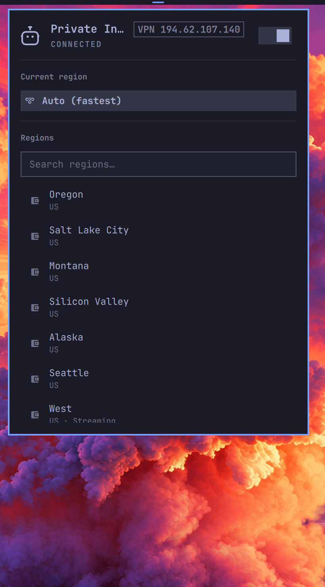

# PIA Panel

A [Private Internet Access](https://www.privateinternetaccess.com/) bar widget
for [Omarchy](https://omarchy.org/): toggle the VPN on and off and pick a
region, straight from the bar.



## What it does

- **Bar icon** — the PIA robot head, bright when connected, dim when
  disconnected. Hover shows state and selected region.
- **Left click** — opens the panel:
  - On/off switch with live connection state and the VPN IP
  - Current region
  - Searchable list of all regions (city + country, streaming-optimized
    regions tagged)
- **Right click** — toggles the VPN without opening the panel
- **Middle click** — refreshes status
- **Keyboard** — `j`/`k` or arrows to move, `Enter`/`Space` to activate,
  `/` to focus search, `t` to toggle, `Esc` to close

State updates arrive the moment they happen through `piactl monitor
connectionstate` — no polling loop. The widget starts nothing but that one
monitor process.

## Dependencies

- The PIA client with its CLI on `PATH` (`piactl`). On Arch/Omarchy:
  `omarchy pkg aur add piavpn-bin` (or any AUR helper: `yay -S piavpn-bin`)
- Enable the daemon once: `sudo systemctl enable --now piavpn.service`
- Recommended: `piactl background enable` — lets the bar toggle the VPN
  while the PIA GUI client is closed

## Install

Copy the plugin into Omarchy's plugin directory and put it on the bar:

```bash
git clone https://github.com/PatrikHallgren/piapanel.git
cp -r piapanel ~/.config/omarchy/plugins/piavpn
omarchy bar put piavpn --section right
```

Reload the shell once so the fresh QML loads:
`omarchy restart shell`.

## Usage

- Toggle: left-click the icon → flip the switch, or just right-click the
  bar icon.
- Pick a location: open the panel, type in the search box
  (`seattle`, `japan`, `streaming`…), click a region — or keyboard: `/`,
  type, `j`/`k`, `Enter`.
- The current region row and the bar tooltip always show what is selected;
  `auto` lets PIA choose the fastest server.

## Configure

The plugin has no settings beyond PIA's own. Region and protocol changes
made here are the daemon's own settings (`piactl set region <id>`), so the
PIA GUI app, this widget, and `piactl` always agree.

## Remove

```bash
omarchy bar drop piavpn 2>/dev/null || true
rm -rf ~/.config/omarchy/plugins/piavpn
omarchy restart shell
```

## Notes

- If the panel shows "No response", the daemon is not running — start it
  with `systemctl start piavpn`.
- Region ids like `sk-str...ized` are PIA's own truncated ids; the widget
  maps them to their full names (Slovakia, streaming-optimized).

## License

MIT — see [LICENSE](LICENSE).
